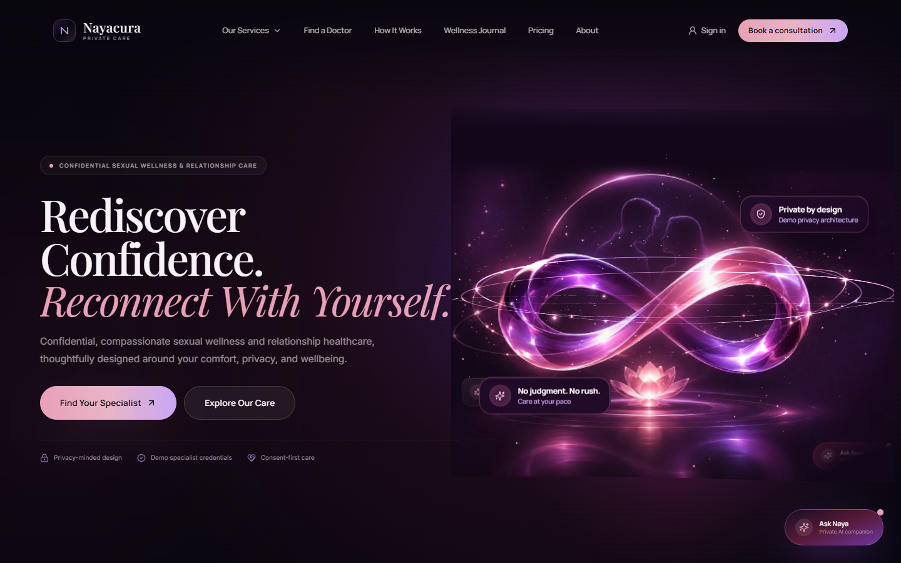
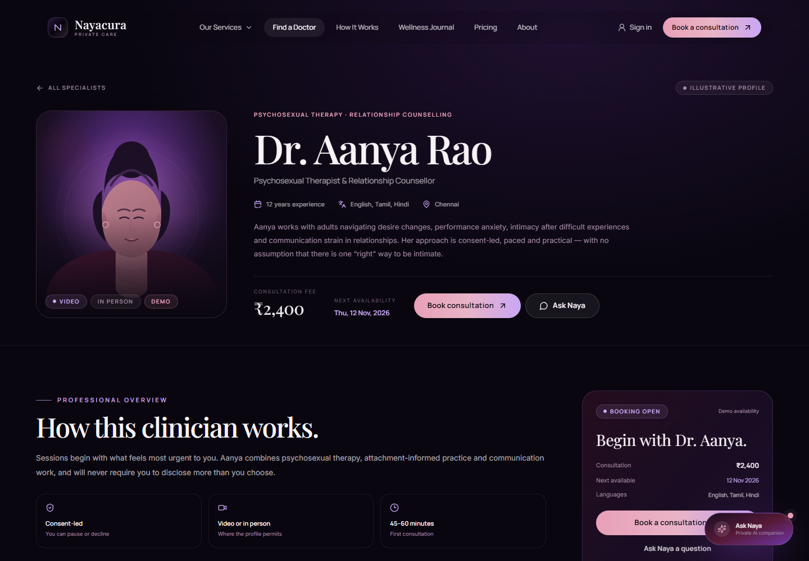
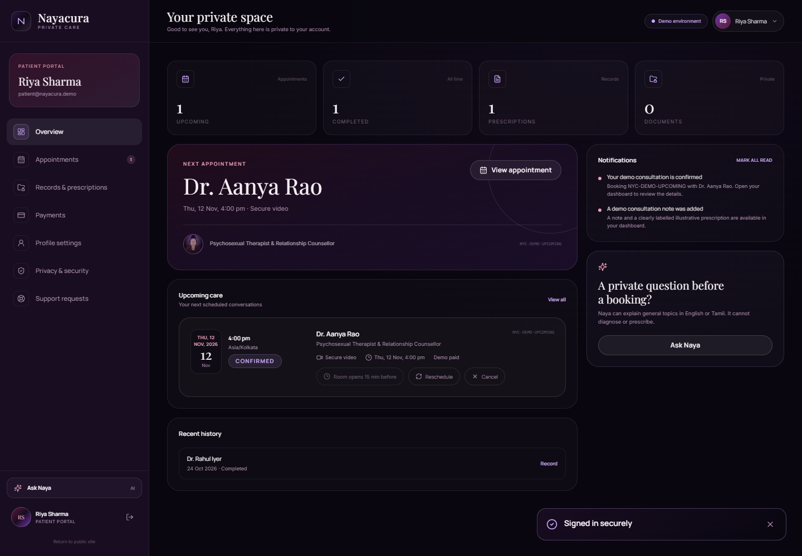
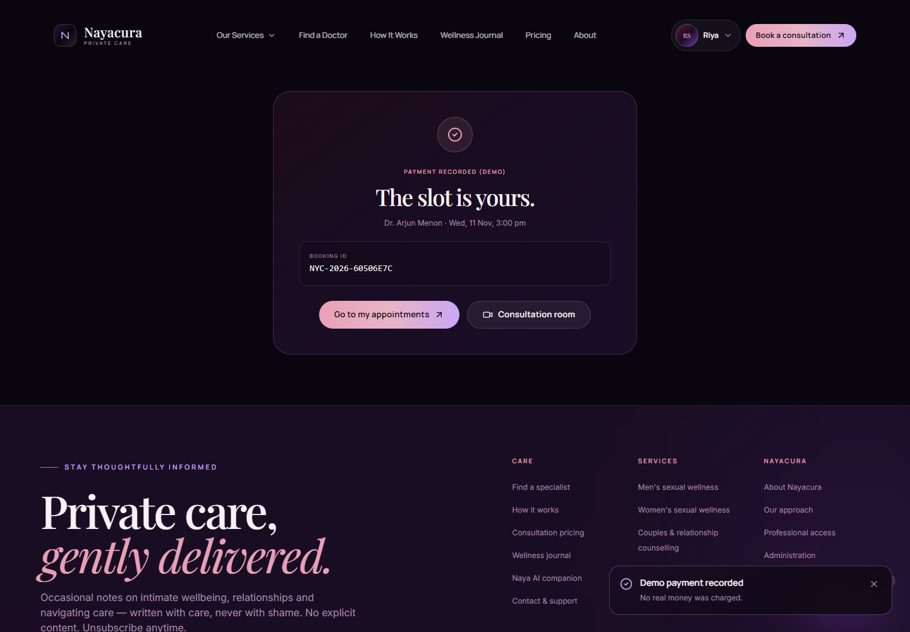

# Nayacura

**Your Wellness. Your Confidence. Your Private Space.**

Nayacura is a premium, full-stack development demo for confidential sexual wellness, relationship counselling and emotional healthcare. It combines a cinematic React experience with a real Express API, database-backed authentication, appointment scheduling with conflict protection, dashboards for patients, clinicians and administrators, an AI wellness companion, optional production integrations and clearly labelled demo adapters.

> **This is not a live clinical service.** All clinicians, portraits, credentials, registration details, clinic locations, availability, fees, reviews and patient stories in the demo are fictional and labelled as such. Nayacura does not claim HIPAA, GDPR, DPDP or any other regulatory certification. Nothing in this repository is medical advice. The legal pages are pre-launch drafts requiring review by qualified Indian legal and clinical professionals.

---

## What this project demonstrates

- A luxury editorial design system using only midnight, plum, purple, burgundy, rose, lavender, ivory, mauve and white.
- A full-screen React Three Fiber hero sculpture with cinematic lighting, mouse parallax, reduced-motion support and a CSS fallback.
- Twenty-six service detail pathways across men's wellness, women's wellness, couples counselling and emotional wellbeing.
- An eight-clinician discovery experience with filters and dynamic profiles. A ninth pending profile exercises the admin credential-review workflow.
- A six-step appointment journey: specialist, format, time, details, payment, confirmation.
- Server-side slot validation, timezone-aware availability, double-booking protection and payment hold expiry.
- Razorpay order creation and signature/amount verification when configured, with a clearly labelled demo payment adapter otherwise.
- LiveKit token issuance and a browser client when configured, with a local-only demo room otherwise.
- Naya AI: streaming responses, English and Tamil, explicit AI identity, emergency escalation, consent-gated encrypted conversation storage and deletion controls.
- Patient, clinician and administrator dashboards with role-based access control.
- Secure clinical notes and prescription records encrypted at the application layer with AES-256-GCM.
- Fifteen original, cautious wellness articles with editorial-draft labelling.
- Nine legal and trust pages, each marked as an unreviewed draft.
- Accessibility-minded forms, focus states, semantic structure, reduced-motion support and responsive layouts tested from 320px to 1920px.
- Twelve automated API workflow tests.

---

## Screenshots

| Home | Specialist profile |
| --- | --- |
|  |  |

| Patient dashboard | Booking confirmation |
| --- | --- |
|  |  |

Additional screenshots are available in [`docs/screenshots`](docs/screenshots).

---

## Quick start

### Requirements

- Node.js **20.11+** (tested on Node 22.18)
- npm **10+**
- No PostgreSQL server is required for the local demo. It uses SQLite through Prisma for a zero-config run.

### Setup

```bash
# 1. Install workspace dependencies
npm install

# 2. Create the local environment file
# Windows PowerShell:
Copy-Item .env.example backend/.env
# macOS / Linux:
# cp .env.example backend/.env

# 3. Create the SQLite schema and seed demo data
npm run db:setup

# 4. Run API and web app together
npm run dev
```

Open:

- Web app: **http://localhost:5173**
- API health: **http://localhost:4000/api/health**

Vite proxies `/api` to the Express server. Cookies remain same-origin through the proxy.

### Demo accounts

All seeded demo accounts use the password **`Nayacura@2026`**.

| Portal | Email | Landing page |
| --- | --- | --- |
| Patient | `patient@nayacura.demo` | `/dashboard` |
| Clinician | `doctor@nayacura.demo` | `/doctor` |
| Administrator | `admin@nayacura.demo` | `/admin` |

The sign-in pages include a **Fill** button that enters the demo credentials. These are deliberately public demo credentials and must never be used in production.

### Available scripts

From the repository root:

| Command | Purpose |
| --- | --- |
| `npm run dev` | Run API and frontend concurrently |
| `npm run build` | Compile backend and build frontend |
| `npm start` | Run the compiled production API, serving `frontend/dist` when present |
| `npm run db:setup` | `prisma db push` plus demo seed |
| `npm run db:reset` | Force-reset the local schema and reseed |
| `npm test` | Reseed and run the 11 critical API tests |
| `npm run typecheck` | Type-check both workspaces |
| `npm run zip` | Create a source-only ZIP using `scripts/package.ps1` |

---

## Demo routes

| Route | Experience |
| --- | --- |
| `/` | 19-section cinematic homepage plus detailed footer |
| `/about` | Concept story, purpose, vision, ethics, privacy and inclusion |
| `/services` | Filterable catalogue of 26 services |
| `/services/:slug` | Service detail, concerns, factors, help guidance, FAQs |
| `/doctors` | Specialist directory with advanced filters |
| `/doctors/:slug` | Dynamic profile, credentials, calendar and sticky booking |
| `/book` | Six-step appointment and payment journey |
| `/payment/:id` | Resume payment for a held appointment |
| `/consult/:id` | Consent screen, waiting room and telehealth interface |
| `/ai` | Naya AI full-page chat with history and privacy controls |
| `/journal` | Searchable, filterable wellness journal |
| `/journal/:slug` | Article with table of contents and reading progress |
| `/how-it-works` | Interactive seven-stage journey |
| `/pricing` | Plan cards, taxes, cancellation and refund transparency |
| `/contact` | Support categories and ticket submission |
| `/login`, `/register`, `/doctor/login`, `/admin/login` | Role-specific auth screens |
| `/forgot-password`, `/reset-password`, `/verify-email` | Account recovery and verification |
| `/dashboard` | Patient overview, appointments, records, payments, profile, privacy, support |
| `/doctor` | Clinician schedule, availability, clinical records, earnings, profile |
| `/admin` | Analytics, credential review, accounts, payments, content, moderation, audit, roles |
| `/legal/:slug` | Nine dedicated legal and trust drafts |
| `*` | Custom cinematic 404 |

---

## Architecture

```text
nayacura/
├── frontend/                 React 18 + TypeScript + Vite
│   ├── public/
│   │   └── images/          Original SVG portraits and editorial artwork
│   └── src/
│       ├── components/      UI, cards, layout, three.js, auth, AI
│       ├── context/         Session/auth context
│       ├── data/            Services, doctors, articles, legal drafts
│       ├── hooks/           Doctor directory queries and fallback
│       ├── layouts/         Marketing and auth layouts
│       ├── lib/             Typed API client and utilities
│       ├── pages/           Public pages and dashboards
│       ├── styles/          Design system and accessibility styles
│       └── types/           Shared frontend contracts
├── backend/
│   ├── prisma/
│   │   ├── schema.prisma              Local SQLite schema
│   │   ├── schema.postgresql.prisma   Production PostgreSQL schema
│   │   ├── migrations/                SQLite init migration
│   │   ├── postgresql/migrations/     PostgreSQL init migration
│   │   └── seed.ts                    Demo seed
│   ├── src/
│   │   ├── config/          Environment, Prisma
│   │   ├── controllers/     (reserved for further decomposition)
│   │   ├── middleware/      Auth, CSRF, rate limiting
│   │   ├── routes/          Auth, doctors, appointments, AI, dashboards
│   │   ├── services/        Sessions, slots, payment, email, serializers
│   │   ├── utils/           Errors, logging, encryption, audit, HTTP
│   │   ├── validators/      Zod schemas
│   │   ├── app.ts           Express application factory
│   │   └── index.ts         Server entry point
│   └── tests/               Critical API workflow tests
├── docs/                    Architecture, API, security, deployment, clinical docs
├── scripts/                 Asset generator, browser QA, packaging
├── .env.example
├── package.json
└── README.md
```

### Request flow

1. The SPA calls `/api` through the Vite proxy (development) or the same Express origin (production).
2. A double-submit CSRF cookie protects every state-changing request.
3. Opaque 48-byte session tokens are stored **hashed** in the database and sent in an HTTP-only cookie.
4. Role middleware resolves the session and authorises the route.
5. Zod validates request data before it reaches the database.
6. Sensitive clinical notes, prescriptions and AI messages are encrypted with AES-256-GCM before storage.
7. Appointment creation uses an interactive transaction, checks for overlapping active bookings and expires stale payment holds.
8. Audit records store minimal metadata only — never clinical free text.

See [`docs/ARCHITECTURE.md`](docs/ARCHITECTURE.md) and [`docs/API.md`](docs/API.md).

---

## Database

### Local development

- SQLite at `backend/prisma/dev.db`
- Prisma schema: `backend/prisma/schema.prisma`
- Seed: `npm run db:seed`
- Reset: `npm run db:reset`
- The local database is excluded from git and from the delivery ZIP.

### Production target

The production schema is [`backend/prisma/schema.postgresql.prisma`](backend/prisma/schema.postgresql.prisma) with an accompanying PostgreSQL migration in [`backend/prisma/postgresql/migrations`](backend/prisma/postgresql/migrations). The model covers patients, clinicians, credentials, specialisations, clinics, availability, services, appointments, status history, payments, refunds, consultations, encrypted notes and prescriptions, documents, AI conversations, notifications, reviews, articles, support tickets, consent records, audit logs, plans and platform settings.

See [`docs/MIGRATIONS.md`](docs/MIGRATIONS.md) for the exact PostgreSQL switch procedure.

> The local SQLite setup is a developer convenience only. It is not a production deployment recommendation. The production PostgreSQL migration includes a partial unique index that prevents overlapping active bookings at the database level.

---

## Integrations

| Integration | Configured when | Without configuration |
| --- | --- | --- |
| **Razorpay** | `DEMO_MODE=false`, `RAZORPAY_KEY_ID`, `RAZORPAY_KEY_SECRET` | Clearly labelled demo payment. No real money is charged. |
| **LiveKit** | `DEMO_MODE=false`, `LIVEKIT_URL`, `LIVEKIT_API_KEY`, `LIVEKIT_API_SECRET` | Local-only demo room with device preview. No remote clinician is connected. |
| **LLM** | `LLM_API_KEY` and optional `LLM_BASE_URL`, `LLM_MODEL` | Safe rule-based fallback streamed over SSE. |
| **Email** | `SMTP_HOST`, `SMTP_USER`, `SMTP_PASS` | Email is skipped and logged without content. In local demo, verification/reset links are printed to the API terminal. |

The frontend never receives secret keys. Razorpay order creation, signature verification, LiveKit token issuance and LLM calls all happen server-side.

> Real Razorpay and LiveKit flows are gated by `DEMO_MODE=false`. Set it only after reviewing the legal, clinical, payment and security requirements in the documentation.

---

## Testing

```bash
npm test
```

The test command reseeds the local database and runs 12 API tests covering:

1. Health and anonymous session behaviour
2. Role mismatch rejection
3. Published-doctor filtering and pending-profile exclusion
4. Booking creation, double-booking conflict and demo payment verification
5. Cross-patient access denial
6. Clinician/admin role boundaries
7. AI emergency escalation
8. Tamil AI fallback
9. Consent-gated AI conversation storage and deletion
10. Support ticket creation
11. Access-controlled document upload, download and deletion
12. CSRF rejection for state-changing requests

A browser QA script also exists at `scripts/qa-visual.mjs` for Playwright Core with an installed Chrome. It checks console errors, horizontal overflow and the full booking/AI flow. It is a developer utility, not part of `npm test`.

---

## Security and privacy summary

Implemented:

- bcrypt password hashing (cost 12)
- Opaque, hashed session tokens in HTTP-only, SameSite=Lax cookies
- Double-submit CSRF protection on all state-changing API requests
- Role-based authorisation for patient, doctor and admin routes
- Rate limits on auth, forms, AI and general API traffic
- Zod validation and centralised error handling without database internals
- Helmet security headers; secure-cookie option; HSTS in production
- AES-256-GCM application-level encryption for clinical notes, prescriptions and AI messages
- Access-controlled medical document downloads with MIME/size/magic checks
- Minimal audit log metadata
- Consent records for privacy, teleconsultation, marketing and AI storage
- Data deletion request workflow with lawful-retention caveats
- No card data storage
- No recording by default

Not yet implemented / not claimed:

- Independent security audit or penetration test
- HIPAA, GDPR, DPDP or ABDM certification
- Primary-source medical credential verification
- Formal clinical governance, medical-device classification or telemedicine registration
- DPIA, data-processing agreements or a production retention schedule
- Encryption of the entire database volume (field-level encryption is implemented)
- Malware scanning of uploaded documents
- Distributed rate limiting / Redis (single-node in-memory limits are used)
- Automated gateway refunds
- Real support desk or grievance officer
- Independent WCAG audit

See [`docs/SECURITY.md`](docs/SECURITY.md) for the threat model and pre-launch checklist.

---

## Environment variables

A complete template is in [`.env.example`](.env.example). Copy it to `backend/.env`.

Key variables:

- `DATABASE_URL` — `file:./dev.db` locally, PostgreSQL URL in production
- `DATA_ENCRYPTION_KEY` — long random secret; **mandatory** in production
- `DEMO_MODE` — `true` enables demo payment/video adapters and demo branding
- `COOKIE_SECURE` — `true` behind HTTPS in production
- `TRUST_PROXY` — set to `1` behind a trusted reverse proxy
- `RAZORPAY_KEY_ID` / `RAZORPAY_KEY_SECRET`
- `LIVEKIT_URL` / `LIVEKIT_API_KEY` / `LIVEKIT_API_SECRET`
- `LLM_API_KEY` / `LLM_BASE_URL` / `LLM_MODEL`
- `SMTP_HOST` / `SMTP_PORT` / `SMTP_USER` / `SMTP_PASS` / `SMTP_FROM`
- `TAX_PERCENT` — demo tax configuration only

Never commit a real `.env`. The repository `.gitignore` excludes it.

---

## Build and deployment

```bash
npm run build
NODE_ENV=production npm start
```

In production mode, Express serves the compiled SPA from `frontend/dist` when present. A reverse proxy should terminate TLS and forward WebSocket upgrades for video if LiveKit is self-hosted.

Read [`docs/DEPLOYMENT.md`](docs/DEPLOYMENT.md) before deploying. The short version: this demo is **not production-ready for real clinical care** without the governance, legal review, security testing and operational controls listed there.

---

## Honest limitations

- The AI/doctor/story content is an editorial product, not clinically reviewed. Articles are explicitly unreviewed drafts.
- Fictional clinician portraits are original illustrations, not photographs, to avoid implying that a real person is the clinician.
- No real clinic address, phone number, partnership or accreditation is published.
- No real patient outcome or testimonial is shown. Stories are labelled composites.
- Pricing is demo data, not a tax or healthcare-compliance opinion.
- No third-party analytics or advertising pixels are included. Production privacy-friendly analytics would be added deliberately.
- The demo is a single-node application. Production needs managed PostgreSQL, Redis or a shared limiter, object storage, malware scanning, a CDN/WAF, backups and monitoring.
- LiveKit and Razorpay are optional and cannot be considered operational until tested with real credentials and reviewed operationally.
- Legal pages are marked drafts and intentionally incomplete. They are not legal advice.
- The browser screenshots and QA artifacts are development evidence, not certification.

---

## Documentation

- [Architecture](docs/ARCHITECTURE.md)
- [API reference](docs/API.md)
- [Security & privacy](docs/SECURITY.md)
- [Database migrations](docs/MIGRATIONS.md)
- [Deployment](docs/DEPLOYMENT.md)
- [Clinical & content boundaries](docs/CONTENT-AND-CLINICAL.md)
- [Testing](docs/TESTING.md)

---

## Content and asset notes

All editorial copy, service descriptions, legal drafts and article text in this repository were created for this project. Doctor portraits and abstract artwork are original SVGs generated by [`scripts/generate-assets.mjs`](scripts/generate-assets.mjs); they do not depict real people.

The project uses Google Fonts (Playfair Display, Manrope, Inter). A production deployment should self-host fonts, document the provider and evaluate any privacy implications.

---

## Final note

Nayacura is designed to show what a respectful, privacy-minded intimate healthcare platform could feel like — and to be equally clear about what it is not. The most important design decision in this repository is not the 3D scene. It is the refusal to pretend the demo is a real clinic.

If you are experiencing a medical emergency, contact local emergency services. In India, Tele-MANAS is available on **14416** for mental health crisis support.
