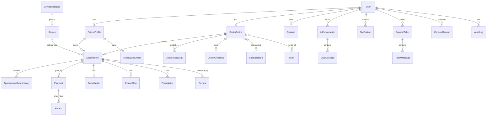

# Architecture

## System context

Nayacura is a two-workspace TypeScript application:

```text
Browser (React SPA)
   │  HTTPS, same-origin /api, HTTP-only session cookie
   ▼
Express API (Node.js)
   ├── Prisma ORM ─────────────── SQLite (local demo)
   │                              PostgreSQL (production target)
   ├── Razorpay ───────────────── optional, server-side order + verify
   ├── LiveKit ────────────────── optional, server-side short-lived tokens
   ├── OpenAI-compatible LLM ──── optional, server-side streaming proxy
   ├── SMTP ───────────────────── optional transactional email
   └── Local upload directory ─── access-controlled medical documents
```

The SPA never contains provider secrets. All privileged calls happen on the API server. In development, Vite proxies `/api` to Express so that cookies remain same-origin. In production, Express serves `frontend/dist` and the API from one origin.

## Frontend

- **React 18 + TypeScript + Vite 6**
- **Tailwind CSS** with a restricted palette. The default Tailwind spectrum is replaced, not extended, so blue/orange/yellow/green utilities are unavailable.
- **Framer Motion** for page/section transitions.
- **GSAP + ScrollTrigger** for scroll-driven homepage artwork.
- **Three.js + React Three Fiber + Drei** for the abstract hero sculpture, lazy-loaded and replaced with an accessible fallback for reduced-motion or missing WebGL.
- **React Router 6** with route-level code splitting.
- **TanStack Query** for server state, with bundled demo fallbacks for public directory data.
- **React Hook Form + Zod** for forms.
- **Lenis** for optional smooth wheel scrolling; disabled for reduced-motion and coarse pointers.
- **LiveKit Client** loaded dynamically only when a LiveKit token is returned.

### Layouts

- `MarketingLayout` — navigation, footer, smooth scroll, Naya floating assistant.
- `AuthLayout` — split-screen authentication experience.
- `DashboardShell` — role-specific sidebar and top bar.
- Standalone routes — booking, consultation room.

### Accessibility

- Skip links, semantic landmarks, visible focus rings.
- `prefers-reduced-motion` disables 3D animation and smooth scrolling.
- Dialog focus trap and Escape handling.
- Responsive layouts from 320px.
- Colour choices are constrained by the brand palette; contrast is generally high on dark backgrounds. This is not a certified WCAG conformance claim.

## Backend

### Application layers

- `routes/`: HTTP route definitions grouped by domain.
- `middleware/`: auth, CSRF, rate limiting.
- `validators/`: Zod payload schemas.
- `services/`: session creation, slot generation, payment provider, mailer, serialisers.
- `utils/`: errors, encryption, audit, logging, async/validation wrappers.
- `config/`: environment validation and Prisma singleton.

The project uses route modules directly rather than a separate controller layer for every endpoint. `controllers/` is reserved in the structure for further decomposition; the current size does not justify splitting every handler yet.

### Authentication and sessions

1. Registration hashes the password with bcrypt (cost 12).
2. Login creates a 48-byte opaque token.
3. Only a SHA-256 hash of the token is stored in `Session`.
4. The raw token is set in a `nayacura_session` cookie: HTTP-only, SameSite=Lax, Secure when configured.
5. Every authenticated request resolves the token, checks expiry/revocation and attaches a minimal user object.
6. Logout revokes the current session; users can revoke all other sessions.

No JWT is used. Opaque server-side sessions support revocation and avoid storing sensitive claims in the browser.

### CSRF

A readable `nayacura_csrf` cookie is issued on first API access. Every non-safe request must echo it in `X-CSRF-Token`. The comparison uses a length-safe comparison. Cross-site scripts cannot read the cookie because of the same-origin policy.

### Authorisation

- `PATIENT`: own profile, own appointments, own documents, prescriptions, payments, own AI conversations.
- `DOCTOR`: only own professional profile, availability, appointments and clinical records; requires `verified=true` and `status=VERIFIED`.
- `ADMIN`: platform operations, credential workflow, payment/refund records, support, content and audit. **No automatic clinical-note or AI-content access.**

Route modules enforce role checks and record ownership server-side. UI hiding is never treated as authorisation.

### Appointment scheduling

1. Availability windows are stored per doctor/weekday with start/end minutes, mode and slot duration.
2. `getAvailability()` renders slots in the doctor’s timezone, excludes times within two hours, and removes slots already booked or held.
3. Booking validates the requested time against the doctor’s window and 30-minute grid.
4. An interactive transaction rechecks for overlaps.
5. A 15-minute `holdExpiresAt` reserves the slot while payment is completed.
6. Expired holds are cancelled on the next booking attempt, releasing the slot.
7. The PostgreSQL migration adds a partial unique index over active bookings for the same doctor/start time, adding database-level protection under concurrency.
8. Payment verification changes the appointment to `CONFIRMED` and creates the consultation room record.
9. Cancellation records a pending refund where eligible; it does not call a live gateway refund in the demo.

### Clinical data

- Clinical notes: AES-256-GCM ciphertext in `ClinicalNote.encryptedContent`.
- Prescriptions: medication JSON and instructions encrypted separately.
- AI messages: ciphertext; conversation titles are deliberately generic and do not contain user text.
- The encryption key is derived from `DATA_ENCRYPTION_KEY` with scrypt and a fixed application salt.
- Decryption occurs only after ownership checks.
- Administrators cannot read these fields.
- There is no production key rotation procedure yet; that is a deployment requirement.

### File uploads

- Raw `application/octet-stream` route, 5 MB limit.
- Allowlist: PDF, JPEG, PNG.
- Magic-byte validation in addition to declared MIME.
- Random storage key, original name sanitised for download.
- Files stored outside the public web root.
- Access checks and audit events on download/delete.
- No antivirus/malware scan in this demo.

### AI

- `POST /api/ai/chat` streams Server-Sent Events.
- If an LLM key exists, the server calls an OpenAI-compatible `/chat/completions` endpoint with a strict system prompt.
- Without a key, a cautious rule-based fallback streams locally.
- Emergency terms are intercepted before the LLM and receive fixed escalation guidance with 112/Tele-MANAS 14416.
- Guest chats are not stored.
- Authenticated storage requires explicit per-message consent and records a consent event.
- Conversations and messages can be deleted individually or all at once.
- This is not a clinically validated triage system. It must not be used as one.

### Payments

- Server creates a Razorpay order only when `DEMO_MODE=false` and both keys exist.
- Signature is verified with HMAC-SHA256 over `order_id|payment_id`.
- The server fetches the payment and verifies order, amount and status before confirming.
- No card data touches Nayacura.
- Refunds are created as `PENDING` records only; no gateway refund is issued.
- Demo mode is simulated and explicitly labelled.

### Video

- Consent must be recorded before a token is issued.
- LiveKit uses short-lived (20-minute) server-generated tokens scoped to the room.
- Rooms are limited to two participants where created through the API.
- No recording is enabled.
- The demo room is local-only and uses `getUserMedia` for preview; it does not imply a remote clinician is present.

### Email

Nodemailer is used only when SMTP is configured. Templates contain booking metadata but **no consultation reason, notes, prescriptions or AI content**. If SMTP is absent, email is skipped and logged without content. Local verification/reset links are printed to the API terminal for demo usability.

### Logging and audit

- Structured JSON logs with redaction of passwords, tokens, cookies, content, reason, email and phone keys.
- Audit events store actor, role, action, entity type/id, minimal metadata and a hashed IP.
- Clinical free text is never written to audit logs.

## Data model



See `backend/prisma/schema.postgresql.prisma` for fields, indexes and constraints.

## Key design decisions

1. **Consent is a product primitive, not a modal.** Teleconsultation consent, AI storage consent, marketing consent and clinical privacy notice acceptance are separate records.
2. **Fictional data is labelled everywhere.** Portraits are illustrations, not photographs of real people. Reviews are not fabricated. Patient stories are labelled composites.
3. **The demo refuses to claim more than it does.** Legal drafts, missing certifications and unconfigured integrations are explicit.
4. **Clinical content is encrypted at the field level** because the local demo has no managed database encryption.
5. **Admins are not clinicians.** A least-privilege boundary prevents operational staff from reading notes or AI conversations.
6. **Payment and video are server-authoritative.** The client never holds provider secrets or long-lived room access.
